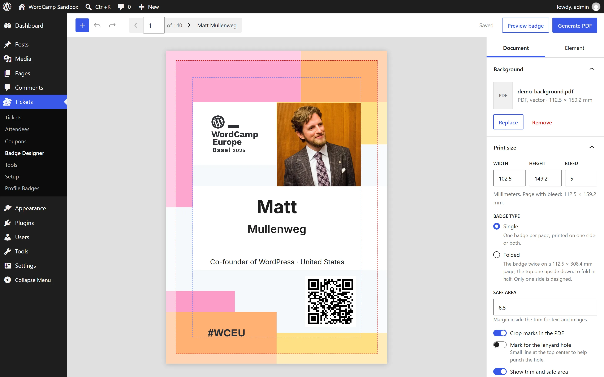
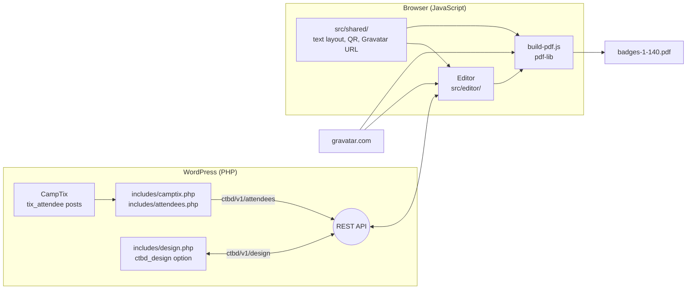

# CampTix Badge Designer

Design printed badges for CampTix attendees in wp-admin, and get one print-ready PDF generated in the browser.

- **User guide** for organizers and testers: https://nilovelez.github.io/camptix-badge-designer/
- **Live demo** in WordPress Playground, no install needed: [open it](https://playground.wordpress.net/?blueprint-url=https://raw.githubusercontent.com/nilovelez/camptix-badge-designer/main/sandbox/demo-blueprint.json) (about 40 seconds to load)



## What it is

Organizers place the attendees' data over their own badge artwork in a visual editor under Tickets › Badge Designer: text boxes with the name and any ticket question, the attendee's Gravatar, and a QR code to their WordPress.org profile. The plugin turns that into a PDF with one badge per page, with bleed and crop marks, ready for the print shop. Badges to fold in half get the design twice per page, the top one upside down.

The PDF is built in the organizer's browser. The server only sends the design and the attendee data: no images are fetched, generated or stored on it, however big the event.

### Status and plan

This is a standalone plugin, in testing. The goal is WordCamp.org: once it has been tested, it will be integrated into `camptix-badge-generator`, the badge plugin that every WordCamp site already runs (in the [`WordPress/wordcamp.org`](https://github.com/WordPress/wordcamp.org) repo), as a new way to make badges next to the HTML/CSS and InDesign ones. It replaces the server-side Canva export proposed in WordPress/wordcamp.org#2278, which embedded every image on the server. The proposal, with how to test it, is [WordPress/wordcamp.org#2286](https://github.com/WordPress/wordcamp.org/issues/2286): feedback goes there.

Background, the name, and the steps to get there: "Name, and the road to WordCamp.org" in [`docs/decisions.md`](docs/decisions.md).

## How it works



### Server

- **Attendees** (`includes/camptix.php`, `includes/attendees.php`): with CampTix active, read live from its `tix_attendee` posts and built as the same table CampTix's own CSV export produces, with the same functions and filters, so both sources go through one reader. Without CampTix (development only), read from a CampTix CSV export in `test-data/`. Only paid tickets get a badge, numbered in `Attendee ID` order so new tickets never shift printed ones; activity tickets (Contributor Day) belong to the main ticket and get none. Names written all in capitals or all in lowercase are normalized, unless the design turns it off.
- **What reaches the browser** (REST route `ctbd/v1/attendees`, `manage_options` only): the badge number, the attendee ID, the normalized names (and the names as typed), the validated WordPress.org username and profile URL, the SHA-256 Gravatar hash (on WordCamp.org, also the WordPress.org account's), the answers to the event's own questions (no other export column becomes a variable) and the CampTix admin flags. Never email addresses, buyer or payment data, or the sensitive common questions (allergies, accessibility needs).
- **Design** (`includes/design.php`, REST route `ctbd/v1/design`): one design per site in the `ctbd_design` option, saved automatically by the editor and checked field by field on the server.
- **Fonts and colors** (`includes/fonts.php`): Inter, shipped in `fonts/inter/`, plus every font installed with the Font Library, active or not, and the site's color palette (any custom color can be picked too). Every attendee's text is checked against the box's font (`src/shared/scripts.js`): when the font lacks characters Inter has, that text prints in Inter; otherwise the editor warns by script and suggests the Noto font to install. The editor loads WordPress's `regenerator-runtime`, which fontkit's Indic shaper needs.

### Browser

- **Editor** (`src/editor/`): React with `@wordpress/components`, built with `@wordpress/scripts`. Toolbar, canvas and a Document/Element sidebar; drag, resize, snap, nudge, undo and redo; text boxes with variables; Gravatar and QR code options; export and import of the design as JSON. Every string is translatable (`@wordpress/i18n`).
- **Same result on screen and on paper** (`src/shared/`): one text layout, measured with fontkit from the same font files the PDF embeds, one QR path and one Gravatar URL builder, used by the editor and the PDF generator.
- **PDF** (`src/editor/build-pdf.js`): [pdf-lib](https://pdf-lib.js.org/). A PDF background is embedded once as a vector object and reused on every page; fonts are subset; each Gravatar is downloaded and embedded once; QR codes are vector paths. Text that does not fit its box shrinks to 80% at most, then is cut at a whole character and ends with an ellipsis, exactly as in the editor. pdf-lib is loaded only when a PDF is made, so the editor loads without it. A folded badge draws the same face twice per page, the top one turned 180°, both clipped at the fold. WOFF2 fonts from the Font Library are converted to TTF first.
- **Preview**: [PDF.js](https://mozilla.github.io/pdf.js/) shows the PDF background in the editor and the one-page preview.

Measured: 140 badges with Gravatars, 11 MB, in 6 to 8 seconds; 300 badges in about 11 seconds, most of it downloading Gravatars. A stress test with 3,000 badges, all with a photo, took 22 seconds and made a 214 MB PDF: big events print in batches. Details and the reasons behind each choice are in [`docs/decisions.md`](docs/decisions.md); what the plugin does, in [`docs/specification.md`](docs/specification.md).

## Repository

| Path | What it is |
|---|---|
| `camptix-badge-designer.php`, `includes/` | The plugin's PHP. |
| `src/editor/`, `src/shared/` | The editor and the PDF generator. Built into `build/`, which is not in Git. |
| `src/vendor/ladyqr/` | QR encoder from [LadyQR](https://github.com/nilovelez/ladyqr). |
| `fonts/inter/` | Inter 4.1, static TTF, with its license. |
| `sandbox/` | WordCamp sandbox for Playground: the real CampTix from `WordPress/wordcamp.org`, invented attendees and a sample design. It also installs CampTix Admin Flags, with Volunteer and Organizer flags on some attendees. `demo-blueprint.json` is the public demo. |
| `guide/` | The user guide, published to GitHub Pages. |
| `docs/` | Specification, decisions, milestones and backlog. |
| `tests/` | PHP and JavaScript tests and invented fixtures. |
| `AGENTS.md`, `HANDOFF.md` | Working rules and current state, for anyone picking up the work (people or AI agents). |

## Development

Requirements: PHP 8.3+, Composer, Node.js 20.18+ and, optionally, [WordPress Studio](https://developer.wordpress.com/studio/).

```bash
composer install && composer lint
npm install && npm run build
```

The build (`build/`) is not in Git: run `npm run build` after cloning and after changing `src/`, or `npm start` to rebuild on every change.

### Test sites

Both run in [WordPress Playground](https://wordpress.org/playground/), mount the repository as the plugin, and log in as `admin` / `password`:

```bash
# WordCamp sandbox: the real CampTix with invented attendees and a sample design.
# The editor is at Tickets › Badge Designer.
npx @wp-playground/cli@latest server --blueprint ./sandbox/blueprint.json --mount-dir . /wordpress/wp-content/plugins/camptix-badge-designer

# Without CampTix: attendees from a CampTix CSV export in test-data/ (ignored by Git).
npx @wp-playground/cli@latest server --blueprint ./blueprint.json --mount-dir . /wordpress/wp-content/plugins/camptix-badge-designer
```

Then open http://127.0.0.1:9400/. The sandbox creates the same data every time; raise `CTBD_SANDBOX_VERSION` in `sandbox/wordcamp-sandbox.php` to rebuild it.

### Checks

- `composer lint`: WordPress Coding Standards for the PHP.
- `npm run lint:js`: ESLint, including the i18n rules.
- `php tests/php/attendees-test.php`: the attendee reader, without WordPress.
- `npm run test:js`: the scripts check and the Inter fallback, with the Noto fonts the Font Library installs. Run `npm run fetch-test-fonts` once first: it downloads them (about 9 MB) into `tests/fonts/`, ignored by Git.
- Plugin Check passes on a release-like copy (`git archive` plus `build/`).

### Builds and publishing

- `.github/workflows/dist.yml` builds the plugin on every push to `main` and publishes it, ready to install, to the [`dist`](https://github.com/nilovelez/camptix-badge-designer/tree/dist) branch: `git archive` (development files are excluded in `.gitattributes`) plus `build/`. The public demo installs it from there. Never commit to `dist` by hand.
- `.github/workflows/pages.yml` publishes `guide/` to GitHub Pages.

## Credits

- [pdf-lib](https://github.com/Hopding/pdf-lib) and [@pdf-lib/fontkit](https://github.com/Hopding/fontkit) (MIT), [PDF.js](https://github.com/mozilla/pdf.js) (Apache-2.0), [woff2-encoder](https://www.npmjs.com/package/woff2-encoder) (MIT).
- QR encoder from [LadyQR](https://github.com/nilovelez/ladyqr) (GPL-2.0).
- [Inter](https://rsms.me/inter/) by Rasmus Andersson (SIL Open Font License).
- The demo badge background is the WordCamp Europe 2025 badge.

## License

GPL-2.0-or-later.
